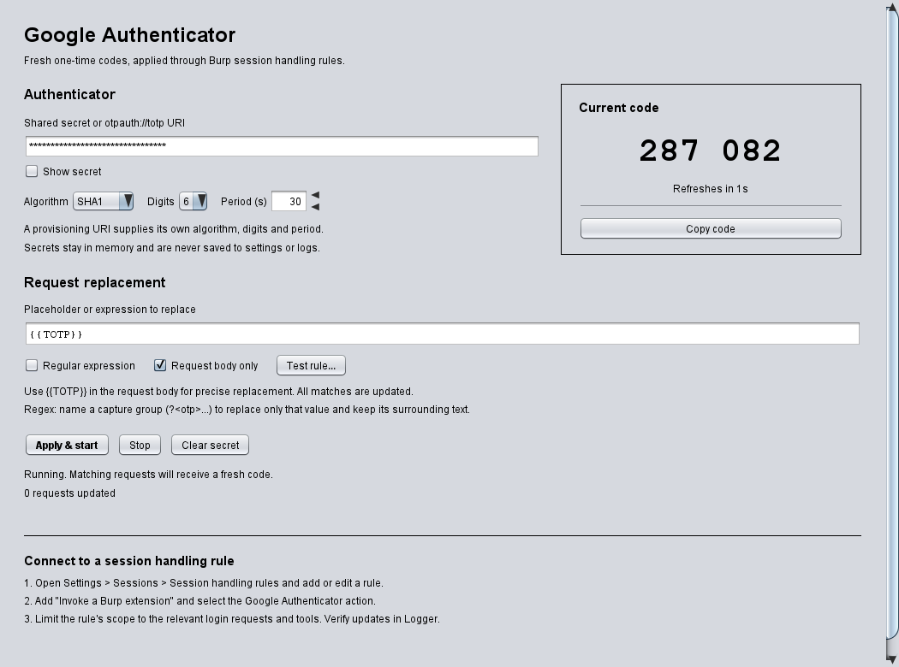

# Google Authenticator for Burp Suite

Apply fresh time-based one-time passwords to requests through Burp session handling rules.
Works with Google Authenticator and other clients that provision standard **RFC 6238 TOTP** secrets,
including Microsoft Authenticator's TOTP accounts. Push approvals and proprietary authentication methods are not supported.

Version 2 modernises the extension with Java 21, Burp's Montoya API, a native theme-aware interface,
and no bundled runtime dependencies. **Requires Burp Suite 2026.7 or later and Java 21 or later.**



## Features

- Base32 secrets or `otpauth://totp/...` provisioning URIs.
- HMAC-SHA-1, SHA-256 and SHA-512; 6 or 8 digits; periods from 1 to 300 seconds.
- Codes generated at request-processing time, independently of the UI timer. Leading zeroes are preserved.
- Literal placeholders or compiled regular expressions, with optional named capture replacement.
- Body-only replacement by default, with whole-request matching available for headers and query values.
- Masked secret entry, expiry countdown, copy code, local rule testing, stop/clear controls and request counts.
- Secrets held in memory only; no secret persistence, telemetry, or request/secret logging.

## Build and install

Install **JDK 21** and set `JAVA_HOME`. The build uses a Java 21 toolchain for compilation and tests.
A separate Gradle installation is unnecessary;
the checked-in wrapper downloads its pinned, checksum-verified distribution. The first build needs internet access.

```powershell
# Windows
.\gradlew.bat build
```

```sh
# Linux / macOS
bash ./gradlew build
```

Load **`build/libs/google-authenticator-all.jar`** under **Extensions > Installed > Add**, using extension type **Java**.
The GradleUp Shadow plugin packages the extension and any runtime dependencies into this loadable JAR.
Use `shadowJar` to package without running tests. Gradle also produces a standard plain JAR;
load the `-all.jar` archive in Burp.
The Montoya API is provided by Burp and is deliberately excluded from the JAR, along with test libraries.

## Configure

1. Open the **Google Authenticator** tab. Enter the account's Base32 shared secret or TOTP provisioning URI.
   Spaces and lowercase letters in Base32 secrets are accepted. URI parameters override the algorithm, digits
   and period controls; absent URI parameters use SHA-1, 6 digits and 30 seconds.
2. Place the literal **`{{TOTP}}`** in the login request body:

   ```http
   POST /api/login HTTP/1.1
   Host: example.test
   Content-Type: application/json

   {"email":"tester@example.test","password":"test-password","pin":"{{TOTP}}"}
   ```

3. Leave **Regular expression** unchecked and **Request body only** checked. Click **Apply & start**.
4. Open **Settings > Sessions > Session handling rules**. Add a rule action to **Invoke a Burp extension**
   and select **Google Authenticator: 2FA code applied to selected parameter**.
5. Scope the rule to the relevant login requests and tools. Check the resulting requests in **Logger**
   or Burp's session handling tracer. Burp controls when the action runs; the extension does not add a global HTTP listener.

For a header or query placeholder, uncheck **Request body only**. All occurrences of the configured
placeholder are replaced in the selected area. Literal mode treats punctuation such as `.`, `[` and `$` literally.

### Replace an existing OTP using regex

Select **Regular expression** and use an expression specific to the OTP field, for example:

```regex
"pin"\s*:\s*"(?<otp>\d{6,8})"
```

When a named **`otp`** group exists, only that group's value is replaced; its surrounding JSON remains intact.
Without that group, the entire regex match is replaced. Ordinary numbered groups do not change this behavior.
Use **Test rule...** to preview matches against pasted text, using the sample code `123456`; no traffic is sent.
Avoid broad digit expressions that could replace unrelated numbers. Empty expressions, malformed regexes
and zero-length matches are rejected. Use bounded expressions; Java regex processing has no execution timeout.

### Running and stopping

Editing configuration immediately pauses updates. Click **Apply & start** to validate and activate the changes.
Invalid input leaves the extension paused. **Stop** disables updates while keeping the form available;
**Clear secret** also empties the secret field. Unloading the extension stops its timer and clears its configuration.
A request already being processed may finish using the snapshot it acquired before a stop or edit.
Keep the system clock synchronized with the authenticating server.

## Request handling and privacy

Binary bytes outside replacement matches are preserved. Body changes recalculate `Content-Length`.
Encoded or transfer-encoded body changes are skipped with an explanation in the tab; use uncompressed,
unchunked requests. Header-only replacements can still be applied to such messages. Requests with malformed
HTTP framing, no matches, or invalid runtime matches remain unchanged.

Secrets and codes are not written to extension settings or logs. They exist in JVM memory while configured;
clearing them releases references, but Java does not guarantee immediate erasure of all in-memory copies.
**Copy code** puts the code on the system clipboard. Modified requests can contain OTPs in Burp's history or project file.

## Development

```sh
bash ./gradlew build                  # Compile, test and package
bash ./gradlew test                   # Run tests only
bash ./gradlew shadowJar              # Package only (no tests)
```

Tests cover all 18 RFC 6238 reference vectors, leading zeroes and locale behavior, Base32 and URI validation,
regex/literal matching, named captures, binary preservation and message lengths, encoded-body rejection,
concurrent requests, clock rollover, and Swing start/edit/stop/clear/unload behavior.
CI runs the build on Linux and Windows with Java 21. The Linux job uploads one downloadable extension JAR without a ZIP wrapper.
A live Burp load test is still needed before release.
Gradle's standard `check` task runs the tests and is included in `build`.
Configuration and build caches are enabled. Dependency checksums cover build plugins and application/test dependencies;
when updating a dependency, regenerate verification metadata deliberately and review the checksum changes.

Generated `build/`, `.gradle/`, and IDE compiler output can be removed and will be recreated as needed.
Downloaded Gradle distributions and dependencies normally live in your user-level Gradle home (`~/.gradle`),
not in the repository. Keep `gradle/` and the wrapper scripts: they are part of the build source.

### Source layout and naming

- `burp`: classes that directly implement Burp interfaces.
- `googleauthenticator.otp`: `TotpGenerator` and `TotpInputParser`.
- `googleauthenticator.session`: `AuthenticatorSession`, `RequestReplacementRule`, and `HttpRequestRewriter`.
- `googleauthenticator.gui`: the Swing interface.

Use `UpperCamelCase` for classes, `lowerCamelCase` for methods and fields, and `UPPER_SNAKE_CASE` for constants.
Class accessors use `get`/`is`; records retain their generated component accessors. Include units in time values
such as `periodSeconds`, and use descriptive result fields such as `requestBytes` and `replacementCount`.
Swing component names identify their role (`startButton`, `statusLabel`), factory methods start with `create`,
and unit test classes follow `<ClassName>Test`.

### Upgrading from 1.x

Disable or unload the old extension before loading version 2. Re-enter the secret and match expression;
the old version did not persist them. The action name is retained, but reselect it in existing session rules
if Burp cannot resolve the replacement registration. For old whole-request regex behavior, enable
**Regular expression** and uncheck **Request body only**. Version 2 fixes literal mode to use literal matching.

## Reporting issues

Use the [bug report or feature request forms](https://github.com/aress31/google-authenticator/issues/new/choose).
For bugs, include the extension version, Burp version, environment, and steps to reproduce.
Remove real shared secrets, provisioning URIs, passwords, and tokens from examples, logs, and screenshots.

## References

- [RFC 6238: TOTP and reference vectors](https://www.rfc-editor.org/rfc/rfc6238)
- [Burp session handling rule editor](https://portswigger.net/burp/documentation/desktop/settings/sessions/session-handling-rules)
- [Montoya extension API](https://github.com/PortSwigger/burp-extensions-montoya-api)

## License

Copyright (C) 2018-2026 Alexandre Teyar. Licensed under [Apache License 2.0](LICENSE).
